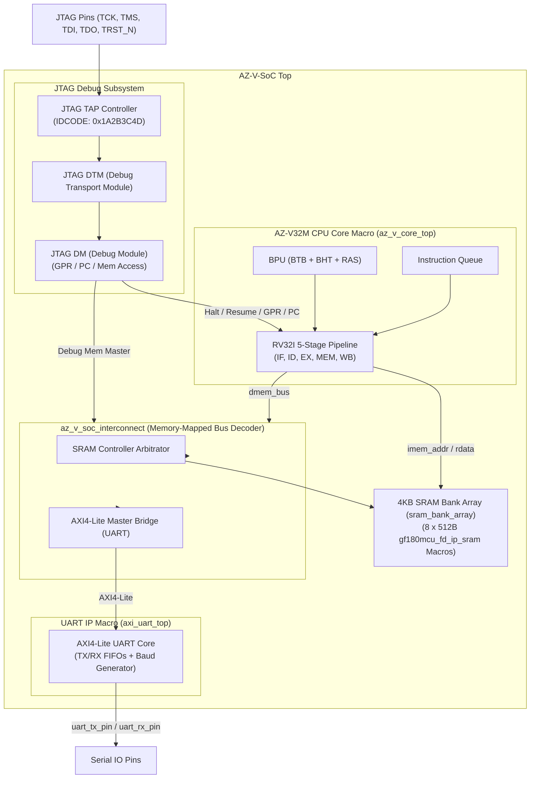
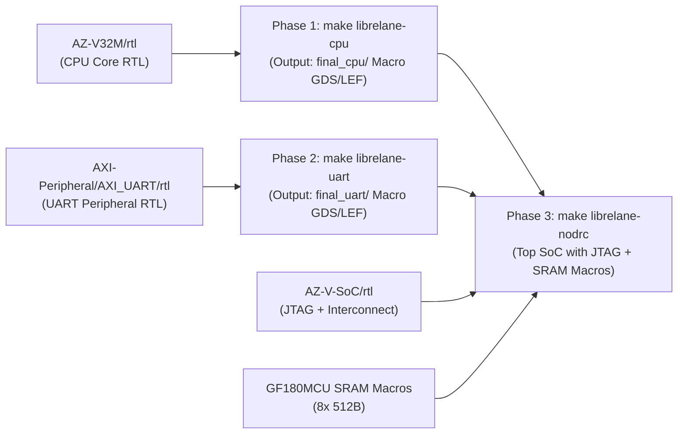

# AZ-V-SoC: 32-Bit RISC-V System-on-Chip

[English](README.md) | [繁體中文](README_zh.md)

**AZ-V-SoC** (formerly **AZ_V_SoC**) is a 32-bit RISC-V System-on-Chip (SoC) architecture integrating the **AZ-V32M** processor core (with BTB, BHT, RAS branch prediction and an instruction queue), an **AXI4-Lite UART** peripheral, an **IEEE 1149.1 JTAG debug subsystem**, and a **4KB SRAM memory array**.

The repository supports a **Hierarchical Hard Macro ASIC PnR Flow** (LibreLane / OpenLane on the GlobalFoundries GF180MCU PDK), directly referencing the CPU core RTL ([`AZ-V32M/rtl`](../AZ-V32M/rtl)) and UART peripheral RTL ([`AXI-Peripheral/AXI_UART/rtl`](../AXI-Peripheral/AXI_UART/rtl)).

---

## System Architecture



---

## Memory Map

AZ-V-SoC implements a unified 32-bit physical address space:

| Address Range | Size / Region | Module | Description |
|---|---|---|---|
| `0x0000_0000` - `0x0000_0FFF` | **4 KB** | **Main SRAM** | Unified Instruction and Data SRAM (8x 512B GF180MCU SRAM primitives) |
| `0x1000_0000` - `0x1000_003F` | **64 B** | **UART IP** | AXI4-Lite UART register block |
| `JTAG DMI Access` | - | **Debug Module** | Hardware debug access to GPR (x0-x31), PC, and SRAM address space |

---

## Hierarchical Hard Macro ASIC Flow (GF180MCU)

This design uses a **LibreLane 3-phase hierarchical PnR flow** to harden sub-blocks into macro GDS/LEF before top-level chip integration:



### 1. Metal Layer Routing Constraints (`RT_MAX_LAYER: Metal4`)
* **Sub-block Macros**: `az_v_core_top` and `axi_uart_top` are constrained to routing layers up to **Metal4** (`RT_MAX_LAYER: Metal4`).
* **Top-Level Integration**: The top metal layer **Metal5** is reserved for top-level power grid distribution (power straps) and inter-macro routing at `chip_top`.

### 2. LibreLane Commands
* **Phase 1: CPU Hard Macro GDS/LEF**
  ```bash
  make librelane-cpu
  # Uses --run-tag az_v_cpu_macro; views saved to final_cpu/
  ```
* **Phase 2: UART Hard Macro GDS/LEF**
  ```bash
  make librelane-uart
  # Uses --run-tag az_v_uart_macro; views saved to final_uart/
  ```
* **Phase 3: Top-Level SoC GDS with JTAG & SRAM**
  ```bash
  make librelane-nodrc
  # Uses --run-tag chip_top_soc; integrates JTAG + CPU Macro + UART Macro + 4KB SRAM Macros
  ```
* **Run Entire ASIC Flow**:
  ```bash
  make librelane-all
  ```

---

## Repository Structure

```text
AZ-V-SoC/
├── Makefile                      # Verilator simulation and LibreLane hierarchical PnR targets
├── librelane/                    # LibreLane flow configuration files
│   ├── config_cpu.yaml           # CPU Hard Macro PnR config (RT_MAX_LAYER: Metal4)
│   ├── config_uart.yaml          # UART Hard Macro PnR config (RT_MAX_LAYER: Metal4)
│   └── config.yaml               # Top-level SoC PnR config (JTAG + Macro placement)
├── rtl/                          # SystemVerilog RTL source files
│   ├── az_v_soc_top.sv           # Top-level SoC wrapper
│   ├── bus/
│   │   └── az_v_soc_interconnect.sv # Memory-mapped address decoder and AXI4-Lite bridge
│   ├── jtag/                     # IEEE 1149.1 JTAG debug subsystem
│   │   ├── jtag_tap.sv           # JTAG TAP controller
│   │   ├── jtag_dtm.sv           # Debug Transport Module
│   │   └── jtag_dm.sv            # Debug Module controller
│   └── asic/
│       ├── sram_bank_array.sv    # 4KB SRAM array (8x 512B GF180MCU SRAM macros)
│       ├── chip_core.sv          # Core integration layer
│       └── chip_top.sv           # Chip padframe top
├── tb/                           # Simulation testbench
│   ├── az_v_soc_tb.sv            # SystemVerilog testbench top
│   └── tb_soc.cpp                # Verilator C++ testbench driver (JTAG validation & VCD trace)
├── sw/                           # Bare-metal C firmware
│   ├── Makefile                  # RISC-V GCC firmware build Makefile
│   ├── common/
│   │   ├── crt0.s                # Startup assembly code
│   │   └── link.ld               # Linker script (4KB SRAM memory layout)
│   └── examples/
│       └── soc_demo.c            # UART and JTAG integration demo firmware
├── README.md                     # English documentation (Homepage)
└── README_zh.md                  # Traditional Chinese documentation
```

---

## Build and Simulation

### 1. Run Verilator Simulation (with JTAG Verification)
From the `AZ-V-SoC` repository root:
```bash
make verilate
```

### 2. Simulation Verification Output

```text
[AZ_V SoC Sim] Starting Simulation with JTAG Verification...

============================================
  AZ_V SoC JTAG Debug Subsystem Verification
============================================

====[JTAG Test 1] Reading IDCODE... 0x1a2b3c4d
[PASS] JTAG IDCODE Match: 0x1A2B3C4D
[JTAG Test 2] Requesting CPU Halt...
[PASS] CPU Halted successfully via JTAG.
[JTAG Test 3] Writing 0xDEADBEEF into GPR x5...
[PASS] GPR Read/Write Verified!
[JTAG Test 4] Overriding CPU PC to 0x00000100...
[PASS] CPU PC Override Verified!
[JTAG Test 5] Writing 0xCAFEBABE to SRAM at 0x00000800...
[PASS] Debug Memory Read/Write Verified!
[JTAG Test 6] Requesting CPU Resume...
[PASS] CPU Resumed execution successfully.

============================================
   AZ_V SoC System Integration Test Demo
============================================
[INFO] CPU Core: AZ_V (RV32I 5-stage pipeline)
[INFO] Peripherals: AXI4-Lite UART & JTAG Debug Subsystem

[STEP 1] Testing UART Transmit & Output...
Hello World from AZ_V SoC (AZ_V + UART + JTAG)!
[INFO] Hex Print Test: 0x1234ABCD

============================================
   [PASS] AZ_V SoC Integration Test Successful!
============================================
```

---

## Related Repositories

* [AZ-V32M](https://github.com/zenbear2/AZ-V32M): 32-Bit RV32I pipelined processor core with branch prediction unit.
* [AXI-Peripheral](https://github.com/zenbear2/AXI-Peripheral): AXI4-Lite peripheral library (UART controller).
* [KU5P-AZ-SoC](https://github.com/zenbear2/KU5P-AZ-SoC): AMD Kintex UltraScale+ FPGA implementation of the SoC.
