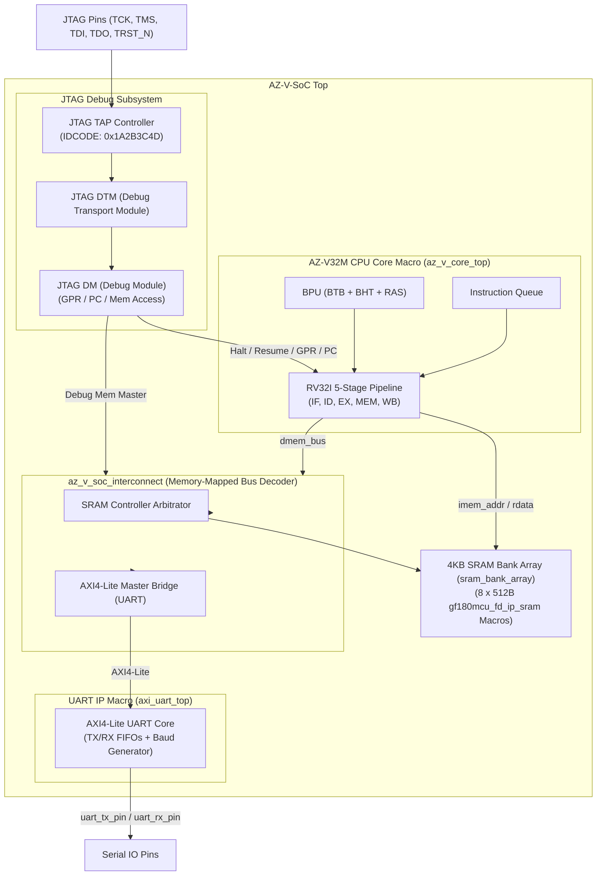
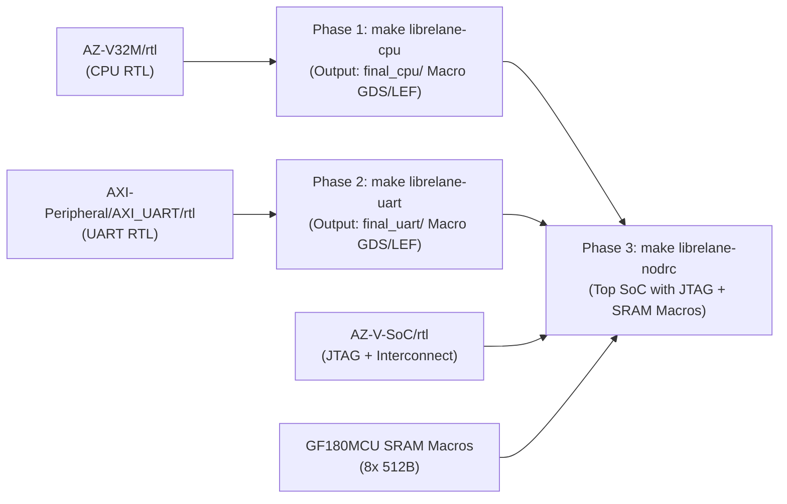

# AZ-V-SoC: RISC-V 32 位元 System-on-Chip

[English](README.md) | [繁體中文](README_zh.md)

**AZ-V-SoC**（亦稱 **AZ_V_SoC**）整合 **AZ-V32M 32 位元 RISC-V 處理器核心**（含 BTB、BHT、RAS 分支預測單元與指令佇列）、**AXI4-Lite UART 週邊**、**IEEE 1149.1 JTAG 偵錯子系統** 與 **4KB SRAM 記憶體陣列**。

本專案支援 **階層式硬體巨集 ASIC 流程 (Hierarchical Hard Macro PnR Flow)**，直接引用包含分支預測器與指令佇列的 CPU RTL ([`AZ-V32M/rtl`](../AZ-V32M/rtl)) 與 UART RTL ([`AXI-Peripheral/AXI_UART/rtl`](../AXI-Peripheral/AXI_UART/rtl))。

---

## 系統架構圖 (System Architecture)



---

## 記憶體映射表 (Memory Map)

AZ-V-SoC 採用統一 32 位元實體位址空間：

| 位址範圍 (Address Range) | 容量/區域 | 模組 (Module) | 描述 (Description) |
|---|---|---|---|
| `0x0000_0000` - `0x0000_0FFF` | **4 KB** | **Main SRAM** | 4KB 統一指令與資料 SRAM（8 顆 512B GF180MCU SRAM 原語） |
| `0x1000_0000` - `0x1000_003F` | **64 B** | **UART IP** | AXI4-Lite UART 暫存器區塊 |
| `JTAG DMI Access` | - | **Debug Module** | 透過 JTAG 存取 GPR (x0-x31), PC 及 SRAM 記憶體 |

---

## ASIC 階層式硬體巨集流程 (Hierarchical Macro GDS Flow)

本專案採用 **LibreLane 3-階段階層式 PnR 流程**，實作硬體巨集分階段產出與頂層整合：



### 1. 金屬層分配設定 (`RT_MAX_LAYER: Metal4`)
* **巨集內部繞線 (Sub-block Macros)**：`az_v_core_top` 與 `axi_uart_top` 繞線上限限制為 **Metal4** (`RT_MAX_LAYER: Metal4`)。
* **頂層整合 (Top SoC Integration)**：最高金屬層 **Metal5** 預留給 `chip_top` 進行全晶片電源網格 (Power Straps) 鋪設與跨巨集信號走線。

### 2. LibreLane 執行命令
* **Phase 1: 產出 CPU Hard Macro GDS/LEF**
  ```bash
  make librelane-cpu
  # 使用 --run-tag az_v_cpu_macro，視圖保存至 final_cpu/
  ```
* **Phase 2: 產出 UART Hard Macro GDS/LEF**
  ```bash
  make librelane-uart
  # 使用 --run-tag az_v_uart_macro，視圖保存至 final_uart/
  ```
* **Phase 3: 產出帶有 JTAG 的 Top-Level SoC GDS**
  ```bash
  make librelane-nodrc
  # 使用 --run-tag chip_top_soc，整合 JTAG + CPU Macro + UART Macro + 4KB SRAM Macros
  ```
* **一鍵執行全流程**：
  ```bash
  make librelane-all
  ```

---

## 專案目錄結構 (Directory Structure)

```text
AZ-V-SoC/
├── Makefile                      # Verilator 模擬與 LibreLane 階層式 GDS Makefile
├── librelane/                    # LibreLane 晶片與 Macro 設定檔
│   ├── config_cpu.yaml           # CPU Hard Macro PnR 設定 (RT_MAX_LAYER: Metal4)
│   ├── config_uart.yaml          # UART Hard Macro PnR 設定 (RT_MAX_LAYER: Metal4)
│   └── config.yaml               # Top SoC 晶片層級 PnR 設定 (含 JTAG + Macro 宣告)
├── rtl/                          # SystemVerilog RTL
│   ├── az_v_soc_top.sv           # Top-Level SoC 頂層模組
│   ├── bus/
│   │   └── az_v_soc_interconnect.sv # 記憶體映射匯流排解碼與 AXI4-Lite 轉接器
│   ├── jtag/                     # IEEE 1149.1 JTAG 偵錯子系統
│   │   ├── jtag_tap.sv           # JTAG TAP 控制器
│   │   ├── jtag_dtm.sv           # Debug Transport Module
│   │   └── jtag_dm.sv            # Debug Module 控制器
│   └── asic/
│       ├── sram_bank_array.sv    # 4KB SRAM 陣列 (8 顆 512B GF180MCU SRAM Macros)
│       ├── chip_core.sv          # Core 整合層
│       └── chip_top.sv           # Chip Padring 頂層
├── tb/                           # 模擬測試平台
│   ├── az_v_soc_tb.sv            # SystemVerilog 測試平台模組
│   └── tb_soc.cpp                # Verilator C++ 測試驅動程式 (含 JTAG 驗證與 VCD 波形)
├── sw/                           # 裸機 C 語言韌體
│   ├── Makefile                  # 韌體編譯 Makefile
│   ├── common/
│   │   ├── crt0.s                # RISC-V 啟動組合語言程式
│   │   └── link.ld               # 連結器腳本 (4KB SRAM Layout)
│   └── examples/
│       └── soc_demo.c            # UART 輸出與韌體測試主程式
├── README.md                     # 英文說明文件 (首頁)
└── README_zh.md                  # 繁體中文說明文件 (本文件)
```

---

## 編譯與模擬驗證 (Build & Simulation)

### 1. 執行 Verilator 模擬 (含 JTAG 驗證)
在 `AZ-V-SoC` 根目錄執行：
```bash
make verilate
```

### 2. 模擬驗證輸出結果

```text
[AZ_V SoC Sim] Starting Simulation with JTAG Verification...

============================================
  AZ_V SoC JTAG Debug Subsystem Verification
============================================

====[JTAG Test 1] Reading IDCODE... 0x1a2b3c4d
[PASS] JTAG IDCODE Match: 0x1A2B3C4D
[JTAG Test 2] Requesting CPU Halt...
[PASS] CPU Halted successfully via JTAG.
[JTAG Test 3] Writing 0xDEADBEEF into GPR x5...
[PASS] GPR Read/Write Verified!
[JTAG Test 4] Overriding CPU PC to 0x00000100...
[PASS] CPU PC Override Verified!
[JTAG Test 5] Writing 0xCAFEBABE to SRAM at 0x00000800...
[PASS] Debug Memory Read/Write Verified!
[JTAG Test 6] Requesting CPU Resume...
[PASS] CPU Resumed execution successfully.

============================================
   AZ_V SoC System Integration Test Demo
============================================
[INFO] CPU Core: AZ_V (RV32I 5-stage pipeline)
[INFO] Peripherals: AXI4-Lite UART & JTAG Debug Subsystem

[STEP 1] Testing UART Transmit & Output...
Hello World from AZ_V SoC (AZ_V + UART + JTAG)!
[INFO] Hex Print Test: 0x1234ABCD

============================================
   [PASS] AZ_V SoC Integration Test Successful!
============================================
```

